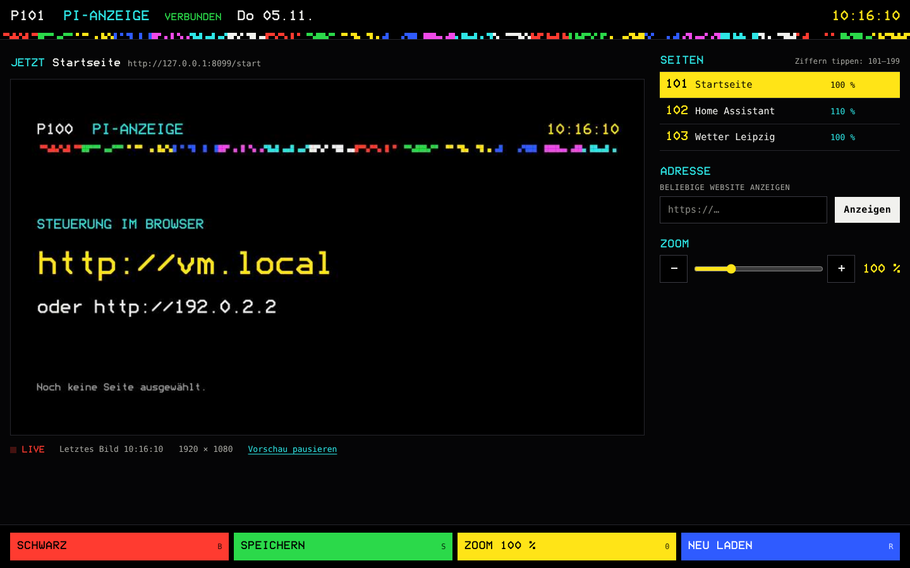

# Pi-Anzeige

Turns a Raspberry Pi 3B and a screen into a full-screen web display you control from any browser on your network. Pick which website it shows, set the zoom, blank the screen to black, and watch a live picture of what is on the screen — the Pi only captures that picture while a control panel is open.



The control panel is in German and styled like teletext: type a page number (101–199) anywhere to switch pages, `B` toggles black, `R` reloads, `S` saves the current address as a page, `0` resets zoom.

## How it works

- `cage` runs Chromium full-screen on the Pi with the DevTools protocol bound to `127.0.0.1:9222`.
- A small Node.js server (`bin/pi-anzeige.js`) keeps Chromium on the chosen URL, zoom and black state, stores everything in `/var/lib/pi-anzeige/config.json`, and serves the panel on port 80.
- The live preview uses Chromium's screencast and stops as soon as no panel is watching.

Design and decisions: [`docs/superpowers/specs/2026-11-05-pi-anzeige-design.md`](docs/superpowers/specs/2026-11-05-pi-anzeige-design.md).

## Set up the Pi

1. Flash **Raspberry Pi OS Lite (64-bit)** with Raspberry Pi Imager. In the Imager settings set the hostname (e.g. `anzeige`), user, Wi-Fi, and enable SSH.
2. Boot the Pi with the screen connected, then:

   ```bash
   ssh <user>@anzeige.local
   sudo apt update && sudo apt full-upgrade -y
   sudo apt install -y git
   git clone https://github.com/maximal7000/pi-browser-kiosk-teletext.git
   cd pi-browser-kiosk-teletext
   sudo ./deploy/install.sh
   ```

3. The screen shows the start page with the panel's address. Open `http://anzeige.local` on your PC.

The repository is private, so `git clone` needs a GitHub login on the Pi (for example a [personal access token](https://github.com/settings/tokens) with read access, entered as the password).

### Update

```bash
cd ~/pi-browser-kiosk-teletext && git pull && sudo ./deploy/install.sh
```

## Check on the Pi

- [ ] After boot the screen shows the start page with `http://<hostname>.local`.
- [ ] Entering an address in the panel switches the screen within a few seconds.
- [ ] Saved pages switch by click and by typing their number.
- [ ] Zoom changes the layout on the screen; "Zoom übernehmen" stores it on the page.
- [ ] Red key turns the screen black and back.
- [ ] The preview updates while the panel is open; `journalctl -u pi-anzeige` shows no errors after closing it.
- [ ] After `sudo reboot` the screen comes back with the same page, zoom and black state.

## Troubleshooting

```bash
journalctl -u pi-anzeige -u pi-anzeige-kiosk -b --no-pager | tail -n 100
systemctl status pi-anzeige pi-anzeige-kiosk
```

- **Panel says "VERBINDET NEU"** – Chromium is not running yet or crashed; the kiosk service restarts it within seconds.
- **"SEITE NICHT ERREICHBAR"** – the Pi cannot load that address; it retries after 30 s, 60 s and then every 5 minutes.

## Develop

Needs Node.js ≥ 20.

```bash
npm install
npx playwright install chromium   # browser for the integration and UI tests
npm test
```

Run against a local Chromium: start Chromium with `--remote-debugging-port=9222`, then `PORT=8080 PI_ANZEIGE_DATA=./data/config.json npm start`.
